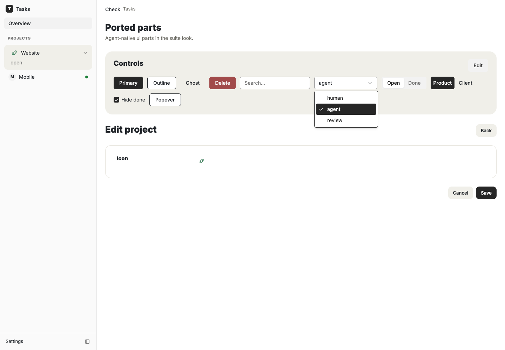

# @jaetask/toolkit

One shell and one page kit for every Kit app, so each app looks and works the same: a light grey sidebar with the app's pages and its projects, warm grey sections with one Edit button each, and edit pages with labelled rows, Back, Cancel and Save.



## Install

```bash
npm install @jaetask/toolkit react react-dom
```

Import the styles once at the app's root. They load Inter from `fonts/` beside `styles.css`, so a bundler picks the fonts up, and an app that serves `dist/styles.css` directly serves `dist/fonts` with it:

```ts
import "@jaetask/toolkit/styles.css";
```

## Use

```tsx
import {
  AppShell,
  EditLink,
  Panel,
  PageBody,
  StatusDot,
  ListCard,
  ListRow,
} from "@jaetask/toolkit";

<AppShell
  app={{ name: "Tasks" }}
  title="Website · Profile"
  nav={[{ href: "/today", label: "Today", icon: <IconSun size={16} />, current: true }]}
  groups={[
    {
      label: "Projects",
      items: projects.map((p) => ({
        id: p.id,
        href: `/p/${p.id}`,
        label: p.name,
        status: p.status,
      })),
    },
  ]}
  settingsHref="/settings"
>
  <PageBody title="Profile" line="What this project is and how its tickets are named.">
    <Panel
      id="identity"
      title="Identity"
      line="The name and prefix every ticket carries."
      action={<EditLink to="/p/web/edit/identity" />}
    >
      …
    </Panel>
  </PageBody>
</AppShell>;
```

The edit page that Edit opens:

```tsx
import { EditFrame, Input, Row, useBackTo } from "@jaetask/toolkit";

const back = useBackTo("/p/web/profile");
<EditFrame title="Edit identity" backTo={back} onSave={save}>
  <Row title="Name" line="Shown in the sidebar and on every page." htmlFor="name">
    <Input id="name" value={name} onChange={(e) => setName(e.target.value)} />
  </Row>
</EditFrame>;
```

With a router, pass its link component and location once:

```tsx
<ToolkitProvider link={({ href, ...rest }) => <RouterLink to={href} {...rest} />} location={pathname + search}>
```

## What is in it

| Component                                                         | Use                                                                                                                             |
| ----------------------------------------------------------------- | ------------------------------------------------------------------------------------------------------------------------------- |
| `AppShell`                                                        | Sidebar (app mark, pages with icons, small-caps groups with status dots, Settings, search, collapse), top bar and page.         |
| `SideSection`, `SideLink`                                         | The sections and links inside the selected group item.                                                                          |
| `PageBody`                                                        | Page title, one line, the one primary action, then stacked panels.                                                              |
| `Panel`                                                           | A section: warm grey, title, one line, at most one action.                                                                      |
| `EditLink`, `PageLink`, `PrimaryLink`, `BackLink`                 | Buttons that open pages; edit links carry `?from=` so the way back returns to the same spot.                                    |
| `Card`, `Kicker`, `ListCard`, `ListRow`, `EmptyCard`, `Chip`      | What goes inside a panel.                                                                                                       |
| `StatusDot`, `Dot`                                                | Grey not started, orange in progress, green done.                                                                               |
| `EditFrame`, `Row`, `ChipPicker`                                  | The edit page and its labelled rows.                                                                                            |
| `Board`, `Column`                                                 | Columns with a title, kind chip and count; drag a `ListRow` (with `dragId`) onto a column.                                      |
| `Thread`, `Comment`, `Reactions`, `ActivityRow`                   | Comments with one level of replies, emoji reactions, and activity lines with one action.                                        |
| `Tabs`, `FilterBar`, `SearchInput`                                | Above a list: views, search and selects.                                                                                        |
| `ChipMultiPicker`, `Inline`, `FileButton`, `Thumbs`               | On an edit page: pick many, several controls in one row, images.                                                                |
| `Composer`, `Facts`, `Notice`, `CenteredPage`                     | A one-line input with its button, labelled values, the result of the last change, and a page outside the shell such as sign-in. |
| `Button`, `Input`, `Textarea`, `Select`, `Label`, `ConfirmDelete` | Primitives. `ConfirmDelete` is the only dialog: permanent delete, confirmed by typing the name.                                 |

## The ux-flow skill

[skills/ux-flow](skills/ux-flow/SKILL.md) is the rule these components follow. Install it in an app:

```bash
npx skills add jaetask/toolkit --skill ux-flow
```

## toolkit-guard

`npx toolkit-guard src` fails when an app hand-builds what the toolkit has:

| Rule            | Fails when                                                                                              |
| --------------- | ------------------------------------------------------------------------------------------------------- |
| `own-kit`       | The app defines its own AppShell, Sidebar, Panel, EditFrame, Row, ListRow or another toolkit component. |
| `no-sheet`      | The app imports a sheet or drawer.                                                                      |
| `tokens-only`   | App code or CSS holds a literal colour instead of a `--tk-` token.                                      |
| `shell-present` | No file imports `AppShell` from `@jaetask/toolkit`.                                                     |

A line that must keep a literal ends with the comment `toolkit-guard-allow`.

## Colours

Six named colours for labels, project colours and avatars: `blue`, `teal`, `green`, `amber`, `purple`, `pink`. Pass the name (`<Chip colour="teal">`), never a CSS value.

## Credit

The app shell follows the layout of [agent-native](https://github.com/BuilderIO/agent-native) (MIT, Builder.io).

## Licence

MIT. Inter is under the SIL Open Font License (`fonts/OFL.txt`).
